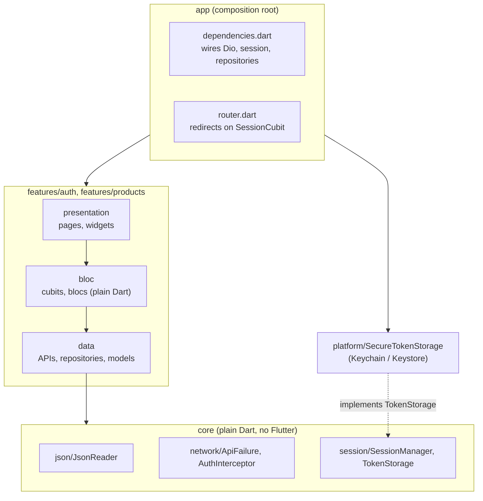
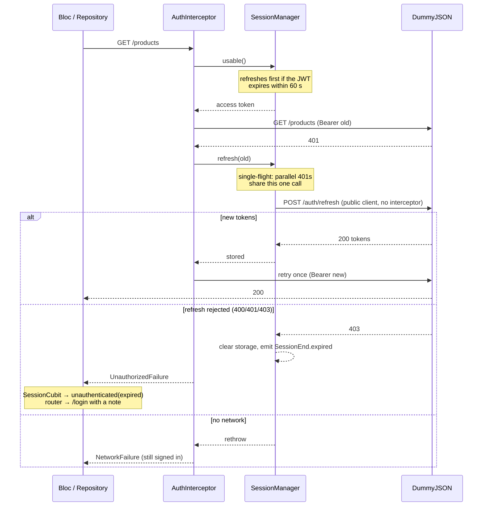

# Architecture

## Layers

Arrows point at what a layer may import. The rules are checked by `test/architecture_test.dart` on every import in
`lib/`:

| Rule | Why |
|---|---|
| `core` imports no Flutter and nothing above it | session and network logic are tested as plain Dart, fast and without widgets |
| `data` and `bloc` import no Flutter, no `flutter_bloc`, no `go_router` | blocs are tested with `bloc_test` alone; UI choices can't leak into logic |
| blocs never import Dio or an `*_api.dart` | a bloc talks to a repository; HTTP errors arrive already translated into `ApiFailure` |
| screens never import Dio, APIs, `SessionManager` or the interceptor | a screen renders state and sends events, nothing else |
| a feature reaches another feature only through its bloc | `products` shows the user and signs out through `SessionCubit`, not through auth's data layer |
| only `app/dependencies.dart` knows `platform/` | the Keychain is swapped for an in-memory store in every test |

## Errors

Every backend call goes through `guardApi`, which turns whatever went wrong into one sealed `ApiFailure`:

| Failure | When | User sees |
|---|---|---|
| `NetworkFailure` | no connection, timeouts | "No connection. Check your internet and try again." |
| `UnauthorizedFailure` | 401 after the one retry, rejected refresh | "Your session has expired..." |
| `InvalidCredentialsFailure` | login 400/401 | "Wrong username or password." |
| `ServerFailure` | any other status | the server's own message for 4xx, a generic one for 5xx |
| `InvalidResponseFailure` | a body that doesn't match the model (`ResponseFormatException`) | "We received an unexpected response..." |
| `UnexpectedFailure` | anything else that is an `Exception` | "Something went wrong..." |

`Error`s (programming mistakes) are not caught: they should crash in development, not become a polite message.
`app/failure_message.dart` is the only place that turns a failure into words; its `switch` is exhaustive, so a new
failure type doesn't compile until it has a message.

## Session

Two Dio clients, on purpose: `public` (login, refresh) has no auth logic, `authorized` has the interceptor. A
refresh that went through the interceptor could try to refresh itself.

On start, `SessionCubit.restore()` asks `GET /auth/me`:

| Result | Session |
|---|---|
| no stored tokens | `unauthenticated` → login |
| 200 | `authenticated(user)` |
| 401, then refresh rejected | `unauthenticated(expired)` → login with "session expired" |
| no network, 5xx | `authenticated()` without a profile: a failed check is not a reason to sign anyone out |

## Navigation

`GoRouter` has one `redirect`, driven by `SessionCubit`: `unknown` → `/splash`, `unauthenticated` → `/login`,
`authenticated` → `/products`. No screen checks "am I signed in?" itself. `ProductsBloc` is created by the
`/products` route, so when the session ends and the route goes away, everything the user loaded goes with it.

The detail route gets the `ProductSummary` the list already has (`extra`), so the page shows image, title and price
in the first frame and loads the rest. Reached without it (`context.go('/products/7')`, a restored route), it starts
with a loader; `/products/abc` shows a not-found page. Platform deep links aren't configured (no URL scheme or
intent filter).

## Product list states

| `status` | Extra flags | Screen |
|---|---|---|
| `initial`, `loading` | | centered loader |
| `failure` | `failure` | message + "Try again" (`ProductsStarted`) |
| `success`, no items | | empty view, still pull-to-refresh |
| `success` | `isLoadingMore` | list + small loader at the end |
| `success` | `loadMoreFailure` | list + message and "Try again" at the end; only that button retries |
| `success` | `refreshFailure` | list stays, snackbar once |
| `success`, `nextSkip >= total` | | list + "You've seen all N products" |

Events are handled one at a time (`core/bloc/sequential.dart`), see
[ADR 0004](decisions/0004-product-list.md).
